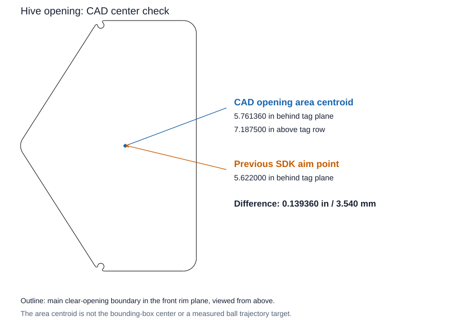

# Four-tag Limelight aiming

Normal turret auto aim projects the center of the cell opening from one AprilTag's
full 3D camera-space pose. It retains the selected tag while usable. If that tag
is lost, upside down, stale, or requires an unreachable turret angle, it selects
another usable tag, preferring the current cell and then the larger tag image.
Opponent-alliance tags are ignored.

The offsets use FTC SDK 12.0's `AprilTagGameDatabase.getBioBuzzCluster()`, checked
against the supplied `am-5865-red1- Red Cell (Audience).step` and
[FIRST's production artwork](https://ftc-resources.firstinspires.org/ftc/field/apriltag-art),
page 2. The STEP models the sticker as one strip, without printed tag geometry;
the artwork supplies the individual centers and IDs.

The tag centers are at X = -6.5, -2.75, +2.75, +6.5 inches in ascending ID order.
The artwork places the row 2.75 inches above the bottom edge of the 17-by-5-inch
sticker. Combined with the STEP placement, the row is 7.1875 inches from the
front rim plane in the sticker plane. This refines the SDK's 7.1874-inch value
by 0.0001 inch (0.00254 mm).

The transformed STEP measurements, in assembly coordinates converted from
meters to inches, are:

- Sticker center X: -1.006935570272.
- Printed tag row Y: +5.877474447189.
- Front rim planar face Y: -1.310025552811 (face entity #51154).
- Their Y difference: 7.187500000000.
- Outward sticker surface Z: -5.870638668815.

These are model dimensions, not measurements of an assembled field. Source STEP
SHA-256: `08aa041d70cdc2bfc341c6de18176bb1a250823c25020ff0043f6354f7d338fe`.

The aim point is now the **area centroid of the main opening cutout in the
front rim plane**, measured directly from the supplied STEP using OpenCascade.
For face #51154, the largest of its 31 inner boundary loops is the main opening;
the other inner loops are small mounting cutouts. Filling that closed main
boundary as a planar face gives the following coordinates in mm and area in mm²:

| Measurement | CAD result |
| --- | ---: |
| Opening centroid X | -25.576163484914 |
| Opening centroid Y | -33.274649041412 |
| Opening centroid Z | -2.775667457085 |
| Main opening area | 142174.621906750 |
| Sticker bounding-box center X | -25.576163484914 |
| Printed tag-row Y | 149.287850958588 |
| Outward sticker plane Z | -149.114222187901 |

The imported units were checked against the sticker's 431.8 by 127 mm
(17 by 5 inch) bounding dimensions. The printed tag row is located from the
production artwork, not the sticker face's area centroid: its mounting cutouts
make those centers slightly different.

Subtracting the tag-row center from the opening centroid gives
`(0, -182.562500, +146.338554731)` mm, or
`(0, -7.187500, +5.761360422)` inches. The code rounds depth to **5.76136 inches**.
This replaces the SDK's 5.622-inch depth with a CAD-derived value, an increase of
0.139360422 inches (3.539755 mm). The target is the opening's area centroid,
rather than its bounding-box center, the rim material's centroid, or the
centroid of the whole hive solid.

The CAD target is a design dimension. It does not validate camera pose accuracy,
assembled-field tolerances, launcher alignment, or ball flight. This model
independently covers the red audience cell; the other cells retain the same
SDK cluster layout. The supplied odometry field coordinates are unchanged.

In Limelight target coordinates (+X right, +Y down), the offsets from the red
audience tags to the retained aim point are:

| Tag | X (in) | Y (in) | Z (in) |
| --- | ---: | ---: | ---: |
| 34 | +6.5 | -7.1875 | +5.76136 |
| 35 | +2.75 | -7.1875 | +5.76136 |
| 36 | -2.75 | -7.1875 | +5.76136 |
| 37 | -6.5 | -7.1875 | +5.76136 |

Other cells use the same SDK cluster geometry with their respective IDs; the
supplied STEP independently covers only the red audience cell. The tag rotation
transforms the offset into camera coordinates before calculating the correction.

## Camera setup

Use the AprilTag pipeline selected by `TurretConfig.pipeline` (default 0):

- Select the 36h11 tag family and enable Full 3D tracking.
- Set marker size to 3.25 inches / 82.55 mm.
- Include all four IDs of each cell that should be available in the pipeline's ID
  filter. Red: close 34–37, far 30–33. Blue: close 38–41, far 42–45.
- Use camera calibration appropriate to the selected resolution.

The robot computes a separate 3D point of interest for each ID using the
individual tag pose. The camera's single global POI is not used for this mode;
there is no need to cycle pipelines or set a new camera POI when tags switch.
Normal TeleOp and autonomous aiming use odometry to get near the selected hive,
then hand control to four-tag Limelight 3D when a usable opening-center error is
less than `TurretConfig.acquireDegrees` (default 10 degrees). In `odo turret test`,
`useVision` enables this same hybrid aiming. Its horizontal error is
`atan2(centerRight, centerForward)` from the 3D point alone; raw tag `tx`,
crosshair offsets, and the pipeline POI are not added to that angle. A centered
opening therefore requests zero correction even when the visible tag is off
to one side. The camera's forward axis must be aligned with the launcher.
Repeated reads of the same frame hold its setpoint rather than adding the error
again. Like DecodeV3, fresh camera frames update the encoder target only when
the opening-center error exceeds `TurretConfig.visionUpdateDegrees` (default
2 degrees). Inside that band, the motor controller holds the last target. If
vision first acquires inside the band, it holds the current encoder angle.
The target and controller remain in degrees, and the full 3D opening projection
is retained. `toleranceDegrees` separately reports alignment. Motor power and
encoder travel limits still apply.

Friction compensation scales linearly with angular error inside
`TurretConfig.staticPowerRampDegrees` (default 2 degrees). It is zero at zero
error and reaches the configured `staticPower` at the ramp boundary, avoiding
a full-power sign flip near the center. Velocity damping remains active in
vision and odometry modes; it responds to measured turret motion rather than
camera or odometry setpoint jumps. The ramp width is tunable in Panels and
requires on-robot validation for friction, settling, and camera noise.

Odometry selects the close or far alliance hive from the robot's Y position and
keeps an aiming angle ready in parallel. When the selected hive has no usable
camera target, its center error is outside the acquisition window, or its camera
target is outside the encoder limits, the turret uses that odometry angle.
An eligible tag returns control to Limelight 3D, including while the robot or
turret is moving. Turning `useVision` off selects odometry only. The SOTM test
retains its separate ballistic aiming.

The turret starts with its encoder angle treated as 0°. After the chassis and
turret have stayed nearly still for at least 200 ms, a fresh 3D tag can also
correct the turret's chassis-relative angle once. That saved offset improves
the odometry fallback. This stationary calibration does not gate or replace
direct camera aiming.

Losing the usable tag re-arms calibration for its next sighting while retaining
the saved offset. The robot must be still again before another calibration is
accepted. `TurretAngleEstimator.applyVisionCorrections` in Panels disables and
clears this offset calibration; Limelight 3D continues to aim while
`useVision` is enabled.

The encoder travel limits still guard motor motion. A manual turret recenter or
marked chassis pose reset clears the offset. Telemetry shows the chassis heading,
relative goal bearing, turret target, and learned offset.

Verify on the robot that each of the four tags produces the same opening aim,
that obscuring the tracked tag hands off smoothly, and that an upside-down cell
is rejected. Software checks do not verify camera calibration or shot accuracy.

References: [Limelight 3D tracking](https://docs.limelightvision.io/docs/docs-limelight/pipeline-apriltag/apriltag-3d)
and [coordinate systems](https://docs.limelightvision.io/docs/docs-limelight/pipeline-apriltag/apriltag-coordinate-systems).
