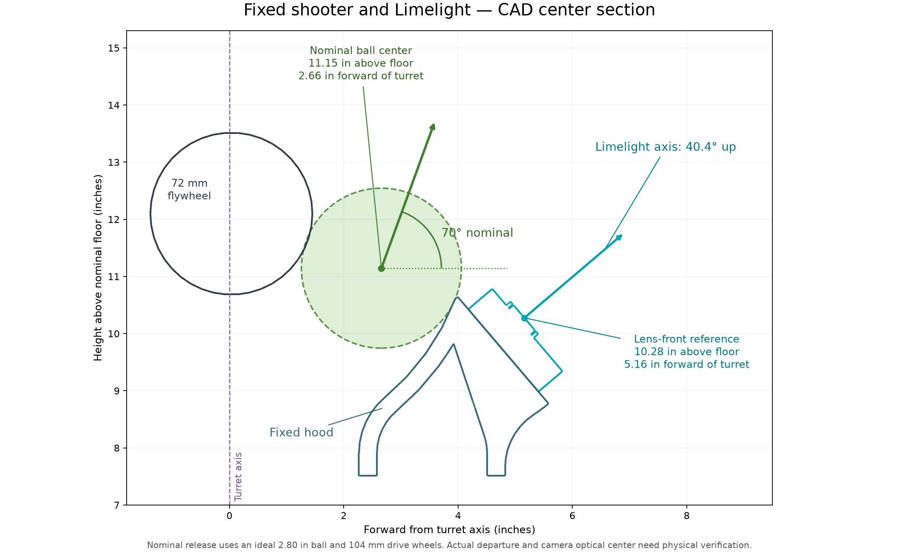

# Robot geometry from CAD

Measured from `Full Robot Copy 1 Copy 1.step`, supplied November 7, 2026.
The assembly contains 395 component instances and 108 unique shape definitions.
The STEP declares meters; the CAD reader converted geometry to millimeters.
The modeled 72 mm shooter wheel and 71.12 mm ball independently check that scale.

Source SHA-256:
`bd8db18687d3c8ca66937f2ffd052b95a0558c234cf2bcc6fd25382833771dae`

The shooter elevation is fixed, as confirmed by the user. Installed turret gears
are 92T and 24T, and the installed turret motor is 1620 RPM. The CAD's 1150 RPM
motor label is therefore not the installed motor specification.



## Useful measurements

| Quantity | CAD result | Interpretation |
| --- | ---: | --- |
| Nominal fixed-hood exit tangent | 70.0° above horizontal | Starting estimate for ball departure; terminal blends, compression, and wheel contact need physical verification |
| Modeled ball diameter | 71.12 mm / 2.80 in | Outer spherical surface, not its perforations |
| Shooter wheel diameter | 72.00 mm | Circular outer tire surface |
| Nominal ball-center release height | about 11.15 in | Ideal ball at nominal hood lip, using nominal floor below |
| Release point forward of turret axis | about 2.66 in | Rotates with the turret; not a fixed chassis offset |
| Release point lateral offset from turret center plane | 0 in | Nominal model center plane |
| Limelight upward mounting angle | 40.394° | Geometric elevation of the modeled lens axis |
| Limelight yaw at the exported turret position | 0° relative to inferred robot forward | Model alignment, not encoder-zero or crosshair calibration |
| Limelight lens-front height | about 10.28 in | Exterior lens-face reference, not a measured optical entrance pupil |
| Limelight lens front forward of turret axis | 5.159 in | Rotates with the turret |
| Limelight lateral offset from turret center plane | 0 in | Model alignment |
| Turret axis behind wheelbase center | 37.00 mm / 1.4567 in | Wheelbase center is not established as the software odometry origin |
| Turret gear-center spacing | 87.00 mm | Large gear at CAD X = 193; pinion at X = 280 |
| Turret external reduction | 92 / 24 = 3.833333:1 | Installed gearing confirmed by user |

The camera lens front is about 2.50 in forward of and 0.87 in below the estimated
release center. Camera mounting elevation and ball launch elevation are different
measurements.

## Coordinate references and floor

CAD +Z is up. Robot forward is inferred as CAD −X from the intake; robot left is
CAD −Y, consistent with the named left drivetrain half. Distances below refer
to the exported, forward-facing turret position.

The four drive-wheel axle centers are at CAD Z = 44 mm. Using their nominal
104 mm diameter gives a nominal floor at CAD Z = −8 mm. The modeled roller
envelope varies slightly with wheel rotation. Loaded tire compression, floor
contact, and pod preload were not measured, so floor-based heights are estimates.

| Reference | CAD X (mm) | CAD Y (mm) | CAD Z (mm) |
| --- | ---: | ---: | ---: |
| Drive-wheel axle centers | 52 and 260 | −32 and −278 | 44 |
| Wheelbase center projected to nominal floor | 156 | −155 | −8 |
| Turret vertical axis | 193 | −155 | any Z |
| 24T pinion vertical axis | 280 | −155 | any Z |
| Hood radial construction center | 192.137732 | −155 | 299.350000 |
| Ideal hood lip on center section | 92.060467 | −155 | 262.924855 |
| Estimated ball-center release | 125.475937 | −155 | 275.087091 |
| Limelight lens-front center | 61.955884 | −155 | 253.005946 |
| Forward-rolling odometry wheel axle center | 289.282926 | −131.1 | 12.255930 |
| Sideways-rolling odometry wheel axle center | 287.9 | −188.282926 | 12.255930 |

The two four-bar odometry pods are in their exported pose, with wheel bottoms
roughly 4 mm above the nominal drive-wheel floor. Their loaded positions can
shift. Existing Pinpoint offsets and encoder directions were retained; a CAD
wheelbase center does not prove the software's reference or sign conventions.

Some components, including a second Rhino wheel and a second ball, are detached
from the assembled robot in this export. Their positions were not used as floor,
release, or robot-envelope measurements.

## How the shooter estimate was obtained

The circular center section of the hood's inner toroidal surface has radius
106.5 mm. The modeled ball radius is 35.56 mm. An ideal sphere against that hood
therefore has a center-path radius of `106.5 − 35.56 = 70.94 mm`.

The nominal lip's radial cut is 20° below horizontal toward the front, giving
a forward/upward circular tangent of 70°. Terminal blends and the contact
patch can change where the real ball stops following that profile. The 70° value
is nominal construction geometry, not an observation of ball flight.

Using hood center `C`, radius `R = 70.94 mm`, and that nominal lip:

```text
release = C + R * (−cos(20°), 0, −sin(20°))
height = (release.Z − (−8 mm)) / 25.4 ≈ 11.15 in
```

The flywheel radius plus ball radius is 71.56 mm, about 0.62 mm larger than the
hood-constrained center-path radius. This is nominal interference/compression;
CAD alone cannot predict its effect on exit speed or departure direction.

## Changes and configuration mapping

- `TurretConfig.ticksPerDegree` now uses the confirmed 92T/24T gearing. With the
  retained 1620 RPM motor ratio and 28 motor counts/revolution, this is
  `28 × (1 + 46/17) × (92/24) / 360 = 1.1049019608 ticks/degree`.
  The previous 90T conversion commanded about 88.04° of physical rotation for
  a nominal 90° request, assuming correct encoder scale and no backlash.
- `SotmConfig.launchAngleDegrees` now starts at the CAD's nominal 70°.
- `goalMinusReleaseHeightInches` remains unset. A starting estimate will be
  `goalAimPointHeightInches − 11.15`, once the intended field aim-point height
  is established. Robot CAD does not establish field-goal height.
- Shooter offsets, feed delay, turret travel limits, camera configuration, and
  odometry offsets were retained. Encoder zero, cables, backlash, and release
  delay cannot be established from this static assembly.

The gear conversion and nominal launch-angle changes compile successfully.
They have not been verified on the physical robot. SOTM remains inhibited by
the unset height difference.

## Rotating muzzle and camera

`ShootingOnMove.Model` currently treats the release offset as fixed to the chassis.
The CAD shows a release point about 2.66 in from the turret axis, so copying a
single measured offset into `shooterForwardInches` would only describe one
turret angle. A complete geometry model should separate the chassis-to-turret
offset from the turret-to-release offset and include turret-induced release
velocity as well as chassis rotation.

If the software odometry reference were confirmed at the wheelbase center, an
ideal geometry approximation would be:

```text
releaseForwardInches = −1.45669 + 2.65843 * cos(turretAngle)
releaseLeftInches    =            2.65843 * sin(turretAngle)
```

Angles are positive counterclockwise from the nominal forward turret position.
This formula is a measurement mapping, not an implemented replacement solver.
It assumes the nominal lip estimate and a verified turret zero.

The camera also rotates about the turret axis. At the exported position its
lens-front reference is 3.7025 in forward of the wheelbase center and 10.2758 in
above the nominal floor. Those are not fixed robot-space camera coordinates
throughout turret travel. The exterior CAD lens face also does not establish
the optical entrance pupil or runtime image rotation/crosshair calibration.

Current `HiveAimGeometry` uses individual tag poses in camera space; it has no
camera mounting-angle field to populate. Its target-to-opening dimensions are
field geometry and were not changed using robot CAD. A future robot-space
camera transform should use the turret encoder angle and established optical
reference. Limelight documents camera space at the lens, with right/down/forward
axes; see its [coordinate-system reference](https://docs.limelightvision.io/docs/docs-limelight/pipeline-apriltag/apriltag-coordinate-systems).

Full-precision values, assumptions, and unresolved inputs are saved in
[the geometry JSON](data/robot-geometry.json).
